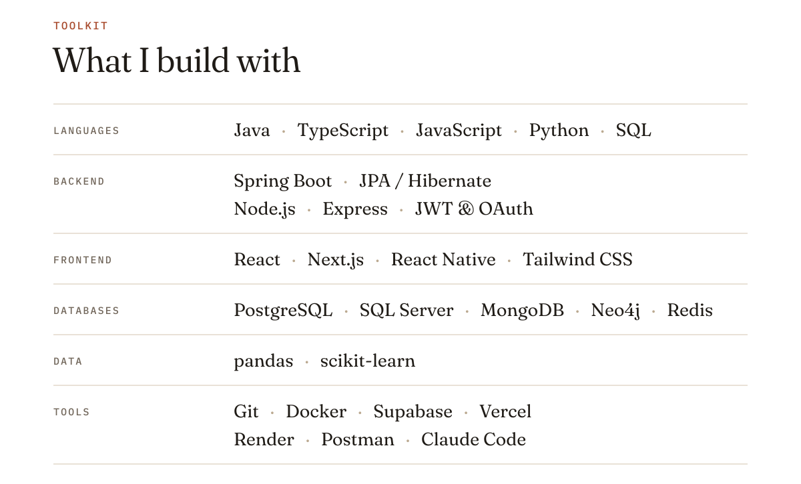

<picture>
  <source media="(prefers-color-scheme: dark)" srcset="assets/hero-dark.svg">
  
</picture>

  

<picture>
  <source media="(prefers-color-scheme: dark)" srcset="assets/stack-dark.svg">
  
</picture>

  

<picture>
  <source media="(prefers-color-scheme: dark)" srcset="assets/relieve-dark.svg">
  
</picture>

  

<a href="https://linkedin.com/in/zagereric"><picture><source media="(prefers-color-scheme: dark)" srcset="assets/linkedin-dark.svg"></picture></a>&nbsp;&nbsp;<a href="mailto:ericzager0@gmail.com"><picture><source media="(prefers-color-scheme: dark)" srcset="assets/mail-dark.svg"></picture></a>
